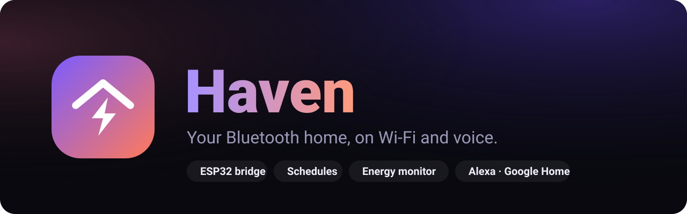
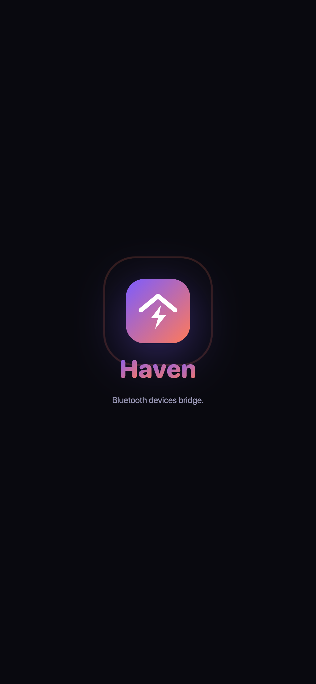
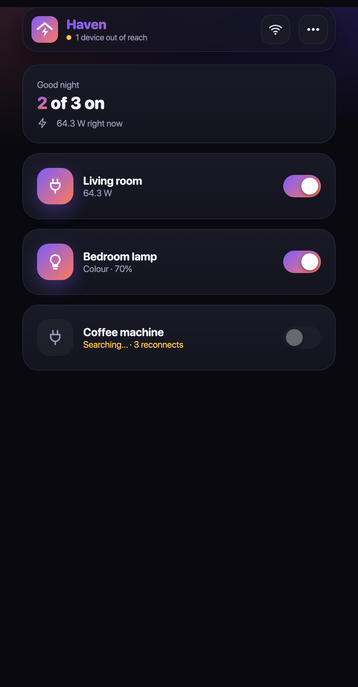
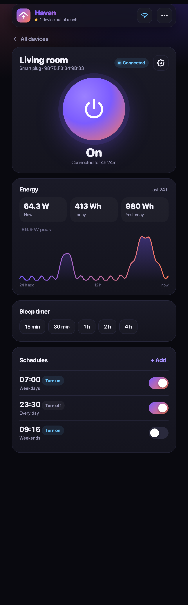
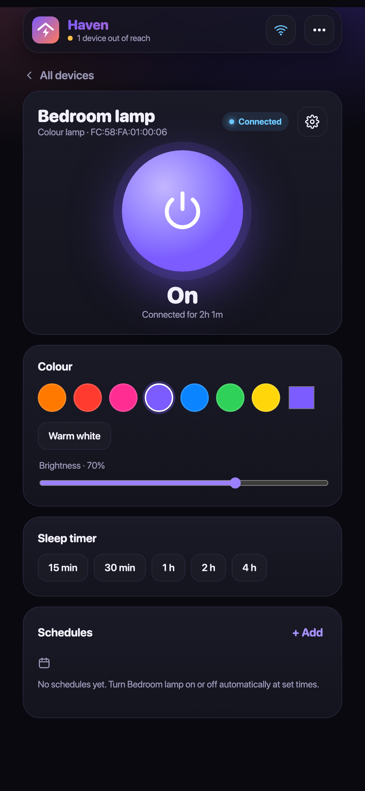
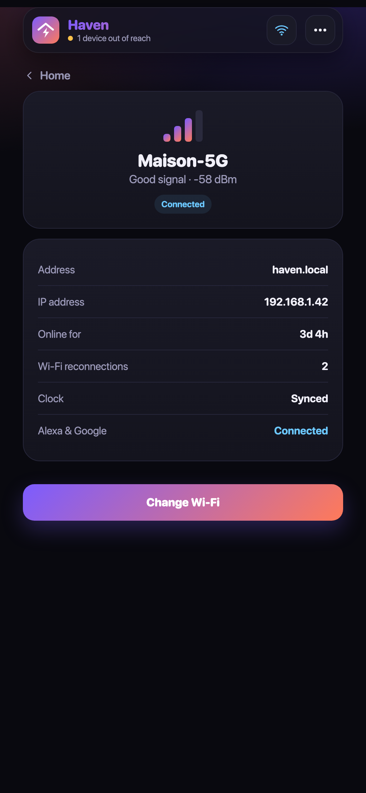
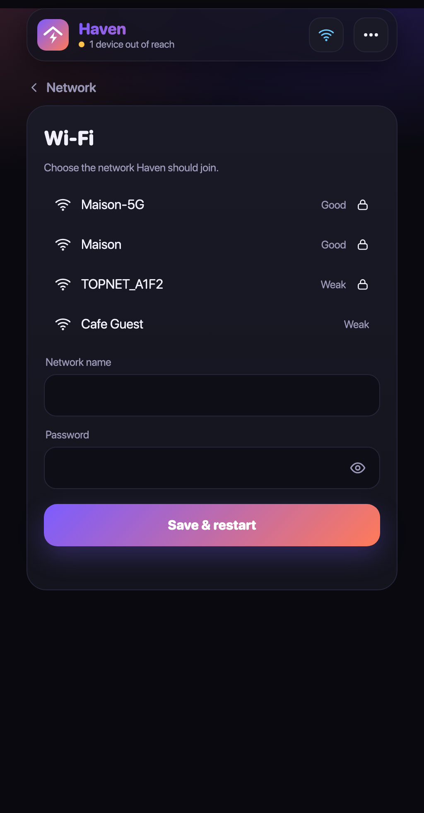
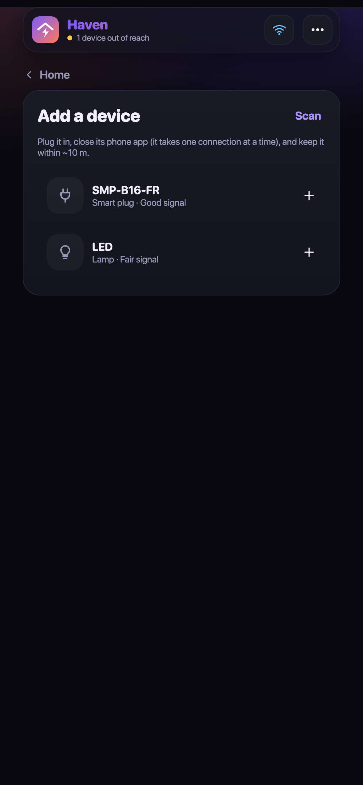
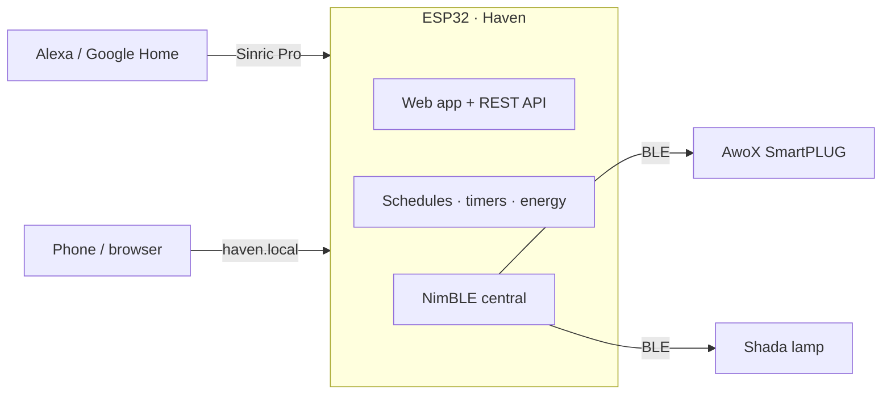

<p align="center"></p>

<p align="center">
  &nbsp;
  
</p>

<p align="center">
  
  
  
</p>

**Haven** turns Bluetooth-only smart devices into Wi-Fi ones. An ESP32 holds the Bluetooth links and puts
the devices on your network with a web app, schedules, energy monitoring, and voice control through Alexa or Google Home.

## Compatible devices

| Device | Type | Haven support |
|---|---|---|
| AwoX SmartPLUG (Revogi SMP-B16-FR, FR socket) | Smart plug | On/off, live power, energy, schedules, timer, Alexa / Google |
| Revogi SMP-B13-UK, SMP-B16-GR | Smart plug | Same protocol; untested |
| Shada LED's light bulb (art. 600750) | Colour bulb | On/off, colour, warm white, brightness, schedules, timer, Alexa / Google |

Protocol notes: [docs/awox_smartplug.md](docs/awox_smartplug.md) and [PLAN.md](PLAN.md).

## Screenshots

<p align="center">
  
  
  
  
</p>
<p align="center">
  
  
  
  
</p>

## Features

- **Up to 3 devices** per bridge: AwoX plugs and Shada lamps, added from the app by a Bluetooth scan.
- **Live control** from any phone or computer on the Wi-Fi, at **http://haven.local**. Installable as a home-screen app.
- **Energy monitoring** for plugs: live watts, a 24-hour chart, today's and yesterday's consumption.
- **Schedules** (weekly on/off rules) and a **sleep timer**, run on the bridge with NTP time, so they work with the app closed.
- **Alexa and Google Home** through [Sinric Pro](https://sinric.pro) (free for 3 devices). Changes from the app,
  schedules or the plug's own button are pushed back so the assistants stay in sync.
- **Network panel**: Wi-Fi name, signal, IP, uptime, reconnections, cloud and clock status.
- **Secure by default**: password on first visit (SHA-256, per-device salt), HttpOnly session cookie.
- **Self-healing**: automatic Wi-Fi and Bluetooth reconnection; a setup hotspot (captive portal) when Wi-Fi is unreachable.

## How it works



| Part | Notes |
|---|---|
| Board | Any ESP32 with Wi-Fi + BLE. Tested on a classic ESP32 (D0WDQ6) DevKit. |
| Power | USB 5 V. Keep it within ~5–10 m of the devices. |
| Toolchain | `arduino-cli`, ESP32 core **3.3.x**, libraries **NimBLE-Arduino 2.x**, **SinricPro 3.x**, **ArduinoJson 7**. |

> NimBLE instead of the stock Bluedroid stack is what makes this fit: it frees ~100 KB of RAM, enough for
> the TLS connection to Sinric Pro next to Wi-Fi and Bluetooth on a classic ESP32.

## Setup

1. **Keys (optional, for voice):** create a Sinric Pro account, add a *Switch* for the plug (and a *Smart Light Bulb* for the lamp),
   then copy `firmware/home_bridge/secrets.example.h` to `secrets.h` and fill in the app key, secret and device IDs.
   Without it Haven runs locally only.
2. **Flash:**
   ```bash
   arduino-cli lib install "NimBLE-Arduino" SinricPro ArduinoJson
   cd firmware/home_bridge
   arduino-cli compile -b esp32:esp32:esp32:PartitionScheme=huge_app .
   arduino-cli upload  -b esp32:esp32:esp32:PartitionScheme=huge_app -p /dev/cu.usbserial-0001 .
   ```
3. **Join Wi-Fi:** on your phone, connect to the **Haven-Setup** hotspot. The setup page opens by itself
   (or browse to http://haven.local); create a password and pick your network.
4. **Add devices:** open http://haven.local → ⋯ → *Add device* → *Scan*. Close the vendor app first; each
   device accepts one Bluetooth connection at a time. The first plug and lamp get the Sinric Pro IDs from `secrets.h`.
5. **Voice:** in the Alexa app enable the **Sinric Pro** skill (or link Sinric Pro in Google Home), then
   *“Alexa, turn on SmartPLUG.”*

**Reset (forgotten password, new Wi-Fi):** hold the board's **BOOT** button and let go after
**3 s** to reset Wi-Fi + password (devices and schedules stay), or after **10 s** to erase everything.
The blue LED blinks slowly, then fast after 3 s, and stays on after 10 s.

### Serial console (115200 baud)

| Command | Does |
|---|---|
| `status` | Wi-Fi, cloud, memory and each device's link and state |
| `scan` | Lists nearby plugs and lamps |
| `dev <n> on\|off\|white\|rrggbb` | Controls device number *n* (colours for lamps) |
| `add plug\|lamp <address> [name]` | Adds a device without the app |
| `wifi-reset` | Forgets Wi-Fi and the password (devices and schedules stay) |
| `factory-reset` | Erases everything, like holding BOOT for 10 s |

## Development

The web app lives in [`web_app.h`](firmware/home_bridge/web_app.h). Preview it without the board, against a fake API:

```bash
python3 tools/preview.py           # http://localhost:8080
python3 tools/preview.py --login   # sign-in screen on :8081
```

[`tools/revogi.py`](tools/revogi.py) talks to the plug straight from a computer (`scan`, `status`, `on`, `off`) using `bleak`.

| File | Contents |
|---|---|
| [`home_bridge.ino`](firmware/home_bridge/home_bridge.ino) | Setup, Wi-Fi, serial console, main loop |
| [`devices.h`](firmware/home_bridge/devices.h) | BLE links, plug and lamp protocols, energy history |
| [`schedules.h`](firmware/home_bridge/schedules.h) | Weekly rules and sleep timers |
| [`cloud.h`](firmware/home_bridge/cloud.h) | Sinric Pro (Alexa / Google Home) |
| [`web.h`](firmware/home_bridge/web.h) | REST API, login, assets |

## Notes

- Plug power readings are assumed to be milliwatts; confirm with a known load.
- Tunisia time zone (`CET-1`) is set in `schedules.h`; change `kTimeZone` for elsewhere.
- Not affiliated with AwoX, Revogi or Shada.
